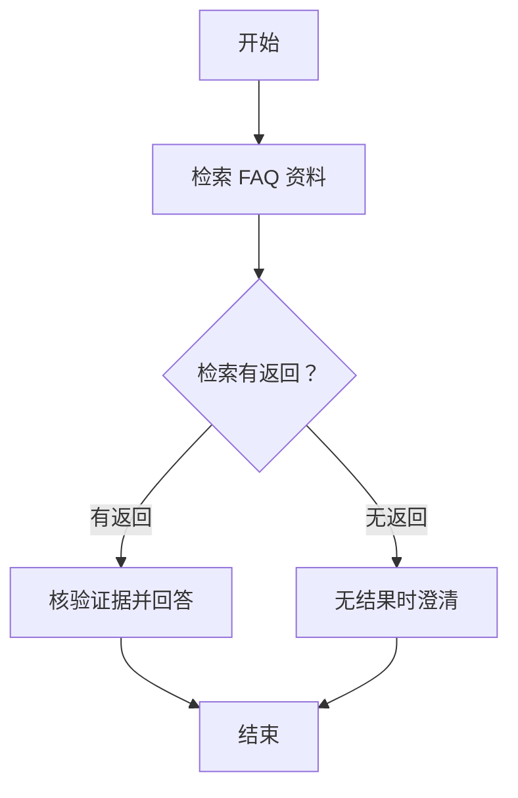

# Skill 画布路径监控讨论稿

记录日期：2026 年 11 月 3 日。状态：讨论稿，尚未实施。

用户明确希望监控 Skill 画布的实际执行路径。本轮仅整理方案、保存文档；页面入口、事件结构和保存方式均为建议，尚未批准开发，也未完成运行验收。

## 1 要解决的问题

现在可以配置一个 Skill 内部的节点和连线，但用户在聊天时无法直接确认：本轮选中了哪个 Skill、实际经过哪些节点、条件判断走了哪条线、当前卡在哪里。

目标是在页面上看到**这一轮问题真实走过的画布路径**，同时能解释分支原因。每轮分别关联自己的轨迹；同一会话中切换 Skill 后，仍能查看各轮各自的执行情况。

## 2 当前已有能力与缺口

下列事实依据本次讨论期间查看的源码；实际部署中的可见范围仍需运行核验。

| 位置 | 已有能力 | 当前缺口 |
| --- | --- | --- |
| [Skill 执行器](../../../../app/aperag/service/agent_chat_service.py) | `_execute_skill` 按节点和连线执行；`_evaluate_condition_node` 根据上一步输出选择分支 | 尚未向页面发送包含节点、实际连线和状态的完整执行事件 |
| [流程画布](../../../../app/web/src/app/workspace/bots/[botId]/flow-canvas-editor.tsx) | 使用 React Flow 编辑节点、工具和连接关系 | 当前是配置编辑器，没有对应某轮回答的只读运行视图 |
| [聊天事件消费](../../../../app/web/src/components/chat/use-chat-messages.ts) | 已有 WebSocket，接收回答、工具调用和结束等事件 | 尚未消费节点执行与分支事件，也没有路径高亮状态 |
| [历史消息](../../../../app/aperag/chat/history/message.py)、[历史保存](../../../../app/aperag/agent/agent_history_manager.py) | 已有会话存储和消息元数据能力 | 尚未完成执行轨迹、画布快照的保存及前端回读；失败、取消也需单独核对 |
| [日志格式器](../../../../app/aperag/logging.py) | 保留结构化事件、追踪标识等允许字段 | 旧的自由文本日志会被省略，现有“经过节点、分支选择”日志不能完整还原路径 |

此前本地检查确认，Langfuse 已收到相关问答的模型和检索调用记录；这只能支持对应调用的观测，不能代替按画布节点和连线组织的轨迹。本稿不把已有工具调用记录视为画布监控已经实现。

## 3 建议的使用方式

建议第一版在每轮回答旁增加“运行路径”入口，打开侧边面板，展示本轮对应 Skill 的只读画布。这个入口便于明确正在看哪一轮；具体位置待确认。

拟议交互：

1. 问题发送后，选定 Skill 时显示本轮的画布。
2. 正在执行的节点显示蓝色和“执行中”；完成显示绿色和“已完成”；失败显示红色和“失败”。未经过的节点保持灰色和“未执行”。状态同时使用文字，不能只靠颜色区分。
3. 只高亮实际走过的连线。条件节点展示判断字段、实际值和选中分支，例如 `has_result = true → 有返回`。
4. 点击节点查看耗时、检索返回数量、状态和必要错误摘要；相关资料通过已有引用入口查看。首版不展开完整模型 Prompt、资料正文或模型内部推理。
5. 回答结束后保留轨迹，刷新页面或重新进入会话后仍可查看。停止、失败、断线与完成分别显示；缺少终态时不能自动标成成功。

以此前讨论的 FAQ 流程为例，下面仅表示要监控的结构，**不是某次实际执行结果**：

这里的 `has_result` 仅表示有无返回引用，不表示证据一定匹配。未知问题也可能检索出无关资料，走“有返回”分支，再由回答节点说明证据不足。监控必须如实显示这条实际路径，不能根据最终答案出现“澄清”就反推走了“无返回”分支。

## 4 建议的实现范围

### 4.1 后端记录真实执行事件

在现有 Skill 执行边界记录本轮开始、节点开始、节点完成或失败、实际选中连线，以及本轮终态。事件由程序实际执行结果产生，前端不通过定时动画、回答文字或工具名称推算路径。

建议复用现有消息 ID 关联一轮执行，并携带 Skill、节点和连线标识、事件顺序、状态、耗时，以及条件判断所需的最小结果。具体事件名和字段由后续接口设计确定，本稿不建立第二套正式接口契约。

记录实际选择的下一条连线，包括现有执行器发生回退时选中的连线；不能只记录条件预期值。路径按执行顺序保存，不能用排序后的节点集合代替路径。

### 4.2 通过现有聊天连接展示

复用现有聊天 WebSocket 传递事件，在前端按会话和本轮消息归集状态，再驱动只读画布。需要处理重复、迟到事件和页面切换，避免上一轮或另一个会话的事件更新当前画布。

画布复用现有 React Flow 及节点渲染能力；运行视图用于查看状态，编辑视图继续管理配置。若需调整共享渲染组件，应明确调用方和兼容范围，避免监控面板触发配置保存。

### 4.3 保存轨迹与当时的画布结构

建议优先复用现有会话存储，保存本轮轨迹及执行时的画布结构快照；存储结构、大小上限、保留期限和运行中更新方式待确定。快照以节点、连线、标签和布局等展示所需信息为限，不包含密钥或整套私有模型配置。

保存快照是为了让后续修改 Skill 后，旧回答仍能显示当时执行的图。旧历史没有轨迹时，应显示“无路径记录”，不能用当前配置补造历史路径。

轨迹作为展示和诊断数据保存，不拼进模型的对话正文。保存与回读沿用 Bot、会话的访问权限；失败或取消时应尽可能保留已观察到的路径，无法确认的状态明确标注。

### 4.4 与现有监控关联

画布以结构化执行事件为依据。保留与现有 Trace 的关联，便于进一步查看 Langfuse 中的模型、工具调用；普通日志只记录必要标识和摘要，不通过恢复完整自由文本日志来实现路径展示。

改动主要涉及 Skill 执行状态上报、聊天事件契约与消费、历史保存和只读画布展示。具体公共变更范围需按[开发流程](../../../specs/development-workflow.md)确认；WebSocket 与历史消息按[接口规约](../../../specs/api-contract-conventions.md)分别维护，不能假定扩展类型后所有调用方都会自动兼容。

## 5 拟议验收方式

| 场景 | 要观察到的结果 |
| --- | --- |
| 有检索返回 | 画布显示实际经过的检索节点、条件值和“有返回”连线；节点详情与服务端事件一致 |
| 真实零命中 | 实际走“无返回”分支并完成澄清；不能用“未知问题”替代零命中，因为未知问题也可能返回无关资料 |
| 节点失败、主动停止或断线 | 显示已观察到的路径及对应终态，不把未执行节点标成完成；缺少终态时明确标注未知或中断 |
| 同一会话切换 Skill、不同会话并行 | 每轮显示自己的 Skill、图和事件，不串到其他轮次或会话 |
| 刷新回看、修改配置后回看 | 已保存轨迹仍可读取；修改后查看旧轮次，使用旧画布快照；无轨迹旧消息明确提示 |
| 既有聊天与权限 | 回答、工具调用、引用及停止行为保持可用；其他用户不能读取无权限会话的轨迹 |

上述均为后续验收建议。本轮只检查文档，不执行这些功能验收，也不把此前的 FAQ 聊天测试升级为路径监控验收。

## 6 待确认项与当前边界

- 页面入口：采用每轮回答旁的侧边面板，还是在 Skill 配置页另设运行记录入口；当前建议前者。
- 节点详情：首版是否仅显示状态、耗时、结果数量和分支原因。
- 保存方式：复用现有会话存储的具体结构，以及失败、取消和中途断线时的保存策略、容量和保留期限。
- 兼容范围：聊天事件、历史响应和画布渲染的受影响调用方，以及如何让无轨迹历史继续正常展示。

用户已确认的是监控真实画布路径这一目标，以及本轮只整理讨论稿。上面的交互和实现方案仍待确认；本稿不改变 Skill 选路、节点执行逻辑、模型配置或业务代码。确认实施范围后，再由后续开发任务实现并记录实际验证结果。
