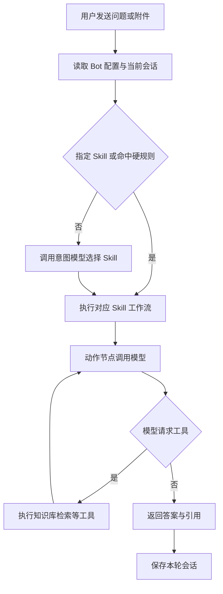

# SAPilot 当前架构与消息处理流程

> 分类：当前说明。整理日期：2026 年 10 月 29 日。
> 状态：当前说明（源码静态核对）。保留文内原有扫描日期与范围；未核对运行中的 Bot 配置或完成端到端验收。
> 使用边界：下文保留原有内容与声明，不因目录分类升级为已定案或已验证；当前行为以源码、实际配置和运行证据为准。分类入口见[设计文档导航](../README.md)。

记录日期：2026 年 10 月 29 日。本文集中说明组件、用户消息处理及 Bot 配置入口；消息链路依据关键源码静态核对，尚未读取运行中的 Bot 配置或执行端到端请求。

产品目标、SAP 领域规则和验收约束见[项目背景](../../../SAPILOT_PROJECT_CONTEXT.md)，平台公共部分见[当前平台架构](platform-architecture.md)，各专题见[当前说明目录](README.md)。用户已确认本轮采用[云服务器与模型 API 部署方向](../discussions/cloud-api-deployment-draft.md)，[离线讨论稿](../discussions/offline-deployment-draft.md)已作废，仅供历史追溯。

## 本地架构整理更新

2026 年 10 月 29 日后续已按用户要求逐批实施并独立审核，具体提交、运行证据和未验项见[实施记录](../../../../records/architecture-implementation-record.md)。下文保留原扫描背景；当前模块归属以本表与最新源码为准，不能把旧静态定位直接当成最新文件内部职责。

| 职责 | 当前源码入口 |
| --- | --- |
| Bot/编排字段定义与保存 | [源 Bot YAML](../../../../aperag/api/components/schemas/bot.yaml)、[编排 YAML](../../../../aperag/api/components/schemas/orchestration.yaml)、[配置更新器](../../../../web/src/app/workspace/bots/[botId]/bot-config-updater.ts)；相关生成类型已采用，未全量覆盖范围外生成差异 |
| Skill 编辑 | [薄编辑器](../../../../web/src/app/workspace/bots/[botId]/skills/skill-editor.tsx)、[状态与保存 Hook](../../../../web/src/app/workspace/bots/[botId]/skills/use-skill-editor.ts)、[配置构造](../../../../web/src/app/workspace/bots/[botId]/skills/skill-config.ts)、[表单分区](../../../../web/src/app/workspace/bots/[botId]/skills/skill-editor-fields.tsx) |
| 意图路由 | [路由与规则模块](../../../../aperag/agent/intent_router.py)；[Agent 服务](../../../../aperag/service/agent_chat_service.py)保留校验、FAQ、历史与上下文、Skill 执行及队列收尾，单次委派路由 |
| Web 聊天 | [聊天 Hook](../../../../web/src/components/chat/use-chat-messages.ts)负责连接、消息状态、发送/FAQ/反馈/取消和滚动；[展示组件](../../../../web/src/components/chat/chat-messages.tsx)保留 JSX，连接路径构造已迁入 Hook |
| 聊天附件 | [附件 Hook](../../../../web/src/components/chat/use-chat-attachments.ts)负责附件业务；[输入组件](../../../../web/src/components/chat/chat-input.tsx)保留输入、发送与 UI，附件状态函数仍未挂接轮询，未将拆分当作功能补齐 |

配置保存已补真实独立 HTTP/PG 回读；聊天、模型效果及完整应用运行仍未端到端验收。意图 provider/model 和 max_tokens 已用于分类请求，尚未实现的阈值、启停、IO 等语义没有因拆分补齐。

## 1 既有源码架构基线

以下保留原 2026 年 9 月 26 日扫描记录及其验证边界；具体消息链路的本轮核对见第 2 节。

本节记录本次对源码和部署配置的架构扫描，作为后续讨论的当前实现基线，不代表端到端验收。产品目标仍以[项目背景](../../../SAPILOT_PROJECT_CONTEXT.md)中的目标章节为准；实现状态以源码及运行验证为准。

### 主要组件与请求链路

- **Web 前端：** `web/` 使用 Next.js App Router。浏览器 API 客户端以 `/api/v1` 为入口，`web/src/middlewares/apiProxy.ts` 将请求代理到 FastAPI；聊天界面构造同源 WebSocket 路径（`web/src/components/chat/chat-messages.tsx`）。WebSocket 的部署代理、鉴权和完整会话链路尚未做端到端验证。
- **API 与聊天：** `aperag/app.py` 创建 FastAPI 应用并挂载 `/api/v1` 下的业务路由，同时提供 OpenAI 兼容 `/v1` 和 MCP `/mcp`。聊天 WebSocket 入口位于 `aperag/views/chat.py`，鉴权后交给 `ChatService`（`aperag/service/chat_service.py`）。
- **两类聊天执行路径：** `ChatService` 按 Bot 类型分发。传统知识库/通用 Bot 加载配置的 Flow，由 `aperag/flow/engine.py` 按节点 Runner 执行并流式返回；Agent Bot 进入 `AgentChatService`，由配置和路由逻辑选择 Skill，再执行其 LLM/MCP 等动作（`aperag/service/agent_chat_service.py`）。实际使用哪些模型、MCP 服务及各部署环境中的可用性由配置决定，未在本次源码扫描中验证。

### 知识摄取、检索与数据层

- **文档摄取：** Collection 文档上传和确认由 `DocumentService` 处理（`aperag/service/document_service.py`），再由 reconciler 和 Celery 文档任务调度解析、建立索引（`aperag/tasks/reconciler.py`、`aperag/tasks/document.py`）。`config/celery.py` 配置 worker 任务及 Beat 周期任务。源码链路显示了任务编排，但各格式的结构保留、解析质量和索引完整性仍需按[项目背景第 4、9 节](../../../SAPILOT_PROJECT_CONTEXT.md)逐项验收。
- **检索：** `CollectionService.execute_search_flow` 根据请求组合向量、全文、图谱、摘要或视觉等检索节点，并可合并、去重及重排（`aperag/service/collection_service.py`）。源码中存在这些路径不等于其对 SAP 场景的召回质量已达标；应按[项目背景第 9 节](../../../SAPILOT_PROJECT_CONTEXT.md)指标验证。
- **默认部署组成：** `docker-compose.yml` 包含 API、Web、Celery worker/beat、Flower、PostgreSQL、Redis、Qdrant 和 Elasticsearch。Docker 环境覆盖配置及模板见 `envs/docker.env.overrides`、`envs/env.template`。当前配置将对象存储指向共享目录 `/shared/objects`，图存储配置使用 `PGOpsSyncGraphStorage`。Neo4j、DocRay/GPU DocRay 和 Jaeger 由可选 Compose profile 提供；服务定义存在不代表它们是默认启用或当前运行中的依赖。
- **状态与消息：** Agent 聊天消息历史使用 Redis 支持的历史存储；Agent 服务另有实例内存中的 Skill 上下文缓冲（`aperag/service/chat_service.py`、`aperag/service/agent_chat_service.py`）。多进程、重启及并发场景下两类状态的一致性和持久性尚未运行验证。

### SAPilot 定制入口与配置

- **钉钉：** `aperag/views/dingtalk.py` 提供 Bot 回调入口，`aperag/service/dingtalk_bot_service.py` 校验配置/签名并复用 Agent 消息处理流程。回调及 Stream 消费的实际部署联通情况未验证。
- **Skill 编排：** Bot 的 Skill 与 orchestration 配置模型定义在 `aperag/schema/view_models.py`，由 Agent 服务读取并执行；代码库也包含相应前端配置入口。此结构证明存在配置驱动的编排实现，不证明第 6 节列出的完整业务流程和证据规则已经满足。
- **ABAP：** 本次扫描未发现专用 ABAP 处理器。钉钉附件扩展名白名单不包含 `.abap`，但通用 MIME 类型回退逻辑仍可能接受部分文本类型，因此仅凭白名单不能断言所有 ABAP 文件都会被拒绝；实际解析和索引支持尚待验证。

### 当前验证边界

[项目背景第 3、5、6、7、9 节](../../../SAPILOT_PROJECT_CONTEXT.md)中的 SAP 术语准确性、来源优先级与冲突处理、证据不足时澄清/拒答、离线与外部访问控制、安全审计，以及 SAP Basis Golden 测试和指标阈值，均不能仅由上述架构代码确认完成。本次也未验证生产环境配置、真实模型/MCP 调用、WebSocket 端到端链路、钉钉联通、文档结构保真度或检索质量；这些状态应继续标记为待验证，直到有对应运行或评估证据。

## 2 用户发来一条消息后怎样处理

当前 [ChatService](../../../../aperag/service/chat_service.py)先按 Bot 类型分发：Agent Bot 进入意图路由和 Skill 执行；knowledge、common 类型沿用各自的 Flow 路径。下图只表示 Agent 文本消息主路径，附件和部分 FAQ 动作还有专门分支。

| 环节 | 当前代码行为 | 是否使用模型 |
| --- | --- | --- |
| 接收与准备 | Web 经 WebSocket 接收消息，加载 Bot、提示词、知识库及历史；钉钉适配后复用 Agent 处理入口 | 配置和历史读取不需要模型 |
| 意图分流 | 有指定 Skill 时直接选择；`rules+llm` 模式先匹配关键词或正则；未命中则调用模型，从启用的候选 Skill 中选一个，非法输出转兜底 Skill | 硬规则不需要，模型分类需要一次独立调用 |
| Skill 上下文 | 按选中 Skill 加载模型运行配置，组合基础系统提示词、Skill 提示词、节点指令和已有输出；知识库存在请求或 Bot 默认值与 Skill 配置的回退关系 | 准备配置本身不需要模型 |
| 动作节点 | 调用模型，可经过工具调用与工具结果回传继续生成；每个动作节点允许多轮迭代 | 使用生成模型，实际调用数取决于执行过程 |
| 条件与起止节点 | 条件节点比较前面节点输出字段并选择 yes/no 分支，起止节点沿连线推进或结束 | 当前由程序执行 |
| 检索工具 | 按工具参数组合向量、全文、图谱、摘要或视觉检索，再合并、去重并按配置重排 | 向量检索使用 Embedding，重排可使用 Rerank；不能把所有检索都计为一次生成调用 |
| 回答与保存 | 返回答案、引用和处理事件；会话保存到 Redis 支持的历史存储，并更新 Skill 上下文缓冲 | 保存不需要模型；答案生成计入动作节点调用 |

核对入口：[Agent 消息处理与节点执行](../../../../aperag/service/agent_chat_service.py)、[检索服务](../../../../aperag/service/collection_service.py)、[MCP 工具](../../../../aperag/mcp/server.py)、[会话历史](../../../../aperag/agent/agent_history_manager.py)。

## 3 谁来配置以及配置什么

普通提问用户通常选择 Bot、发送问题或附件。维护 Bot 的人员预先配置模型、意图路由、Skill 与知识库；下列入口由当前前端源码确认存在，操作权限及页面联通情况尚未运行验证。

| 配置入口 | 主要内容 | 源码依据 |
| --- | --- | --- |
| `/workspace/providers` | 模型服务商、密钥及可用模型；意图路由页面筛选 `api=intent` 的模型 | [供应商页面](../../../../web/src/app/workspace/providers/page.tsx)、[意图配置页](../../../../web/src/app/workspace/bots/[botId]/intent-router/intent-router-editor.tsx) |
| `/workspace/bots/{botId}/intent-router` | 分类模型与提示词、候选 Skill、兜底 Skill、`llm` 或 `rules+llm` 模式及规则 | [意图编辑器](../../../../web/src/app/workspace/bots/[botId]/intent-router/intent-router-editor.tsx) |
| `/workspace/bots/{botId}/skills` | 各 Skill 的模型、提示词、知识库、工具、动作和条件连线 | [Skill 编辑器](../../../../web/src/app/workspace/bots/[botId]/skills/skill-editor.tsx) |
| `/workspace/prompts` | 系统和用户默认提示词，Bot 专属配置可覆盖；Skill 提示词另在执行时组合 | [当前历史与 Prompt 说明](chat-history-and-prompts.md)、[提示词服务](../../../../aperag/service/prompt_template_service.py) |

配置结构见 [Bot 与编排模型](../../../../aperag/schema/view_models.py)。Agent 主路径要求完整的意图路由配置，缺少候选 Skill、兜底 Skill、意图模型或分类提示词时会返回配置错误；只填写一个聊天模型 API 不足以完成这条路径的配置。

## 4 文档目标与当前执行的区别

- [项目背景第 6 节](../../../SAPILOT_PROJECT_CONTEXT.md)规定的澄清、改写、证据核验与拒答是目标行为；不能仅由目标流程推断每次请求都有独立、已验收的执行节点。
- 意图画布与 Skill 画布不能混同：当前意图路由主路径读取规则与候选 Skill 调用模型，并未按意图画布逐节点执行；Skill 画布存在动作、条件及起止节点执行代码。配置中存在字段也不代表该字段已参与执行，例如本轮查看的分类路径未使用 `confidence_threshold` 做阈值判定。
- [早期 Agent 后端设计](../historical/agent-backend.md)及[通用架构](../pending-review/architecture.md)中的部分 HTTP/SSE 描述不等同于当前 Web 的 WebSocket 路径；[归档记录](../../../archive/MEMORY0522.md)中的旧规则不建立当前实现状态。
- [云部署讨论稿](../discussions/cloud-api-deployment-draft.md)中约 118 元/月的数字按每问一次生成调用测算。实际意图分类、多个动作节点和工具循环可能增加调用次数，应累加实测 Token 后修正费用。
- 当前 Bot 实际使用的候选 Skill、提示词、画布、模型和知识库仍需检查运行配置；源码链路存在不等于 SAP 场景效果、隔离规则或并发容量已验证。
