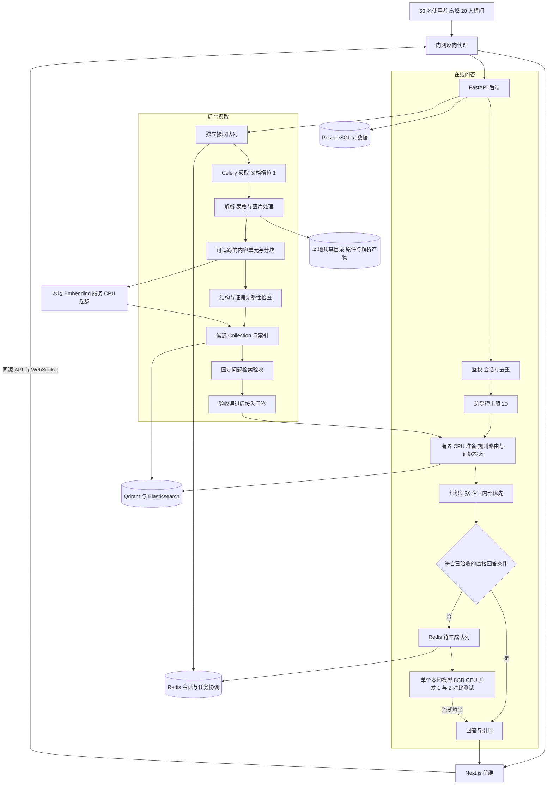

# SAPilot 离线部署架构讨论稿 已作废

> **状态：已作废。** 用户于 2026 年 10 月 29 日明确改用[云服务器与模型 API 部署方案](cloud-api-deployment-draft.md)。本文仅保留历史讨论记录，下文的完全离线、8GB 显存、本地模型及 GPU 排队等方案不再作为本轮部署要求或实现依据。

原讨论记录（2026 年 10 月 28 日）：用户指定先按 50 名使用者、高峰 20 人同时提问设计；当时要求最终部署完全离线，服务器只有 8GB 显存，资料分为企业内部与外部公开两类。人数和高峰是规划输入，不是已经验证的容量。本文中的部署、排队和验收方案尚未实现或压测。

建议复用现有 Next.js、FastAPI、Celery、PostgreSQL、Redis、Qdrant 和 Elasticsearch，在单台服务器上分进程或容器运行。在线请求采用有界的检索准备流水线，经过确认的 FAQ 可直接返回，需要生成的请求才进入 GPU 队列；模型并发 1 为测试基线，并发 2 为优先测试的优化候选。后台摄取避让在线业务。逻辑分层不意味着每层需要单独一台机器。

## 1 约束与未知项

| 项目 | 当前口径 |
| --- | --- |
| 网络 | 最终运行必须完全离线，包括模型、Embedding、文档解析和评测 |
| GPU | 最终服务器只有 8GB 显存；显卡型号尚未确认 |
| CPU 与系统内存 | 型号、核心数、内存容量尚未确认，因此暂不承诺全栈运行容量 |
| 用户规模 | 规划 50 名使用者，高峰 20 人同时提问；每人提问频率、峰值持续时间尚未确认 |
| 使用体验 | 用户明确认为末位等待六七分钟太慢；具体延迟目标尚未确定，不能将串行受理 20 个请求视为体验验收通过 |
| 资料范围 | 最初 7 份测试文件归企业内部；下载的 169 份文档及原文章节归外部公开资料 |
| 来源优先级 | 同一事项且适用范围一致时，企业内部资料优先；外部资料补充未覆盖内容，回答保留来源和必要的冲突说明 |
| 业务范围 | 以 FAQ、SAP 知识问答、ABAP 阅读、运维制度检索为边界；不因本轮架构设计扩展生产操作能力 |

资料分组已记录在 [资料分组与路径约定](../../../../specs/project-layout.md#4-资料分组与路径口径)。这是本地材料分类，尚不能证明运行系统已经执行来源优先级。

## 2 当前实现与文档差异

以下是源码及配置事实，不是运行验收结论。

| 部分 | 当前可确认的事实 | 依据 |
| --- | --- | --- |
| 前端 | 使用 Next.js；浏览器 API 通过同源代理访问后端，聊天入口使用 WebSocket | [前端依赖](../../../../web/package.json)、[API 代理](../../../../web/src/middlewares/apiProxy.ts)、[聊天入口](../../../../aperag/views/chat.py) |
| 后端 | FastAPI 提供文档、Collection、检索和聊天等接口；传统 Flow 与 Agent 聊天路径均存在 | [应用入口](../../../../aperag/app.py)、[聊天服务](../../../../aperag/service/chat_service.py)、[Agent 服务](../../../../aperag/service/agent_chat_service.py) |
| 后台任务 | 摄取和索引由 reconciler 与 Celery 编排；索引任务有状态和版本记录 | [文档任务](../../../../aperag/tasks/document.py)、[调谐器](../../../../aperag/tasks/reconciler.py)、[任务配置](../../../../config/celery.py) |
| 存储 | 默认 Compose 包含 PostgreSQL、Redis、Qdrant、Elasticsearch；Docker 覆盖配置使用共享目录存储对象 | [Compose](../../../../docker-compose.yml)、[环境覆盖](../../../../envs/docker.env.overrides) |
| 可选能力 | Neo4j 和 DocRay 是可选 profile；代码中存在图谱、摘要和视觉索引路径 | [Compose](../../../../docker-compose.yml)、[索引任务](../../../../aperag/tasks/document.py) |
| 并发 | 主部署的 Celery 启动脚本配置 16 个线程；这不是模型生成并发，也不是实测用户容量 | [Worker 启动脚本](../../../../scripts/start-celery-worker.sh) |
| 预览 | 可以读取解析 Markdown、文本 chunk 和视觉 chunk；文本 chunk 读取主要来自向量索引 | [文档服务](../../../../aperag/service/document_service.py)、[预览结构](../../../../aperag/schema/view_models.py) |

现有 [系统架构说明](../pending-review/architecture.md) 将“生产级、高并发”作为能力描述，并在总图中同时展示 Neo4j、MinIO 等组件。当前默认部署不能据此解释成所有组件均已启用，也不能据此承诺并发容量。原有 [本地轻量部署说明](../../deployment/local-lite-business-guide.md) 包含首次联网安装、开发热更新等步骤，不能直接作为最终离线交付说明。

## 3 建议的总体结构

下面是建议结构，其中模型准入、摄取质量验收和候选资料接入问答的控制需要补充验证或实现。

在线问答受理后，先在有界 CPU 槽位中完成不调用生成模型的业务路由、查询 Embedding、检索和证据组织。已验收的 FAQ 或有效缓存可直接返回；其余请求准备好上下文后再进入待生成队列，等待期间不占用 GPU 执行名额。四类业务共用一个本地生成模型服务。任何路由、改写、工具循环、标题生成或最终回答若调用生成模型，都必须取得同一 GPU 名额并计入请求成本，不能以后台调用绕过限制。

后台摄取负责将文件转成可检索证据。候选 Collection 用于验收，不能仅因索引状态变为 ACTIVE 就自动认定内容合格。通过验收后才将候选资料接入正式问答范围。初期可以通过配置指定已通过验收的 Collection，不必先建设复杂的自动发布平台。

## 4 各部分职责

### 4.1 单机部署清单

初版沿用 Compose 方式组织本机进程或容器。API、摄取 Worker 和模型服务分别运行，部署实例数是起步方案，不是实测最优配置。

| 部署单元 | 起步实例数 | 部署与访问方式 |
| --- | --- | --- |
| 内网反向代理 | 1 或复用现有网关 | 统一浏览器入口；页面转发到前端，API 与 WebSocket 转发到后端；支持 WebSocket 升级、心跳和流式输出，超时设置覆盖受理后的等待过程 |
| Next.js 前端 | 1 | 使用生产构建运行；浏览器经统一入口访问，不直接连接模型、Redis 或数据库 |
| FastAPI | 1 个 ASGI 进程起步 | 异步处理鉴权、请求受理、WebSocket 与状态查询；阻塞解析和批量计算交给后台，不能在请求事件循环中执行 |
| 问答调度器 | 1 个逻辑调度器 | 初版在 API 生命周期内协调有界 CPU 准备任务与 GPU 待生成队列；一个调度器可以管理多个异步任务，不代表整轮串行。不新增独立问答微服务 |
| 本地生成模型服务 | 1 | 仅此服务使用问答 GPU；Ollama 作为首版候选，模型采用待实测的 4B 量化候选；通过内网兼容接口供后端调用 |
| 本地 Embedding 服务 | 1 个 CPU 进程 | 独立于生成模型服务，供问答查询和摄取调用，避免换载生成模型；限制 CPU 线程与文档批次，在线查询优先 |
| Celery 摄取 Worker | 1 | 只消费摄取相关队列；任务执行并发从 1 起步，另限制整份文档工作流同时活动数为 1 |
| Celery Beat | 1 | 沿用现有调谐和维护调度；不重复启动多个相同调度器 |
| PostgreSQL Redis Qdrant Elasticsearch | 各 1 | 沿用现有持久卷和访问权限；供应用内部访问，CPU 与内存预算待硬件确定后分配 |
| 本地文件存储 | 1 份共享目录 | API 与 Worker 挂载同一对象目录，保存原件和解析产物；模型与 Embedding 分别使用自己的本地模型目录 |

统一入口的 WebSocket 转发需要单独验收，不能只由普通 HTTP 代理成功推断长连接可用。排队过程中保持连接不等于正在占用 GPU。前端区分检索准备、等待生成、输出中和明确的结束状态；可以先展示检索到的来源卡片，但来源卡片不计作模型首字或完整答案。

### 4.2 职责与资源边界

| 部分 | 应负责的事情 | 资源与边界 |
| --- | --- | --- |
| 前端 | 上传、摄取进度、原文与解析预览、聊天、引用、等待和错误状态 | 用户能区分“已上传”“已索引”“验收通过”“可供问答使用”；不将模型或解析密钥交给浏览器 |
| FastAPI | 鉴权、会话、问答受理、业务路由、检索编排、证据组织、流式响应、请求取消与超时 | CPU；多个连接可以处于等待状态，模型执行名额统一限制 |
| 模型服务 | 执行生成模型推理，限制同时生成数与上下文预算 | GPU；单模型驻留，并发 1 测基线，并发 2 测收益和显存后再决定 |
| 摄取 Worker | 解析、分块、Embedding、索引和验收任务 | CPU 与内存为主；文档处理并发建议从 1 起步，测量后调整 |
| Embedding | 为查询和文档生成同一空间下的向量 | 本地 CPU 起步；使用已验证的同一模型及版本，换模型后需重建受影响索引 |
| PostgreSQL | 用户、配置、文档及任务状态、验收记录引用 | 关系数据；来源与可用状态必须可追踪 |
| Redis | 独立的问答队列与 Celery 摄取队列、会话历史和执行名额协调 | 使用现有 Redis，队列名称和消费方分开；业务状态与恢复依据保存在 PostgreSQL，不把 Redis 配置默认值视为持久性保证 |
| Qdrant 与 Elasticsearch | 分别执行向量检索与全文检索 | 共用同一套基础设施；通过 Collection 与元数据区分两类知识，不必复制两套数据库 |
| 文件存储 | 原始文件、解析 Markdown、图片、分块清单和验收产物 | 先沿用本地共享目录，保留原件与来源哈希 |

第一版问答以全文和向量检索为基线。图谱、自动摘要和大规模视觉索引是否启用，应由验收收益与资源测量决定，本草稿不将它们列为必需依赖。

## 5 摄取与检索如何衔接

建议保留四类可对照的产物：原始文件、结构化解析结果、分块清单、实际索引。每个内容单元需要能追溯到文档与原文位置；表格保留表头和行列关系，图片保留与问题或步骤的对应关系，跨页 FAQ 保留同一编号的关联。

来源分组、文档版本和内容位置随证据传递，不能只写在文件夹名称或回答提示词里。适用版本未知时明确记录未知。对同一事项、同一适用范围的候选证据按企业内部优先组织；优先级可以由程序执行，复杂的语义冲突是否被正确识别仍需要单独验收。

现有全文索引与向量索引入口分别执行分块处理。建议以一份可追踪的分块清单核对两类索引中的内容与来源映射；是否需要统一分块入口，要依据实际差异决定，不在本轮直接重写索引底层。

每批摄取后执行两类验收：

1. 结构验收检查原文证据是否存在、关系是否完整、必要的图表内容是否可用。
2. 检索验收使用从原文标注的固定问题，测 Recall@1/3/5、MRR 和返回证据的完整性。检索配置保持固定，失败后按解析、分块、索引、召回与排序归因。

预期证据标注锚定原文页码、章节、FAQ 编号和必要事实，不固定到某一次分块生成的 chunk ID。改变分块后重新映射内容单元，才能比较不同分块版本。

原有 DocumentIndex.version 与 observed_version 用于索引任务调谐，不直接等同于业务上的“资料验收通过”或“正式可用版本”。

## 6 8GB 显存下的模型与调度

前一版整轮 FIFO 串行方案仅作为测试基线。用户提出末位等待六七分钟不可接受后，建议将目标方案改为“CPU 准备与 GPU 生成解耦、可确认的标准答案直接返回、普通问答减少模型调用、单模型测试小批并发”。这些是待实现和验收的建议，不是已取得的性能提升。

### 6.1 优先减少必须排队生成的工作

| 优先顺序 | 建议 | 生效条件与限制 |
| --- | --- | --- |
| 1 | 已验收的标准 FAQ 直接返回维护的答案、步骤、图片和引用 | 精确 FAQ 编号或已验收的问题映射，权限、SAP 适用环境和资料版本均匹配。只因向量相似度高不能自动当作标准答案 |
| 2 | 普通知识问答使用规则或用户选定的业务入口，检索后尽量只做一次有证据的生成 | 当前 Agent 代码存在模型路由与多轮执行。需记录实际调用链并保留复杂 ABAP 分析所需步骤；不是把所有 Agent 直接限制为一轮 |
| 3 | 用有界 CPU 流水线提前准备其他请求的检索证据 | CPU 准备槽位先以 2 为候选，与 1 对照；阻塞计算不在 API 事件循环执行。CPU、内存和检索延迟未测，不直接同时启动 20 份计算 |
| 4 | 对有效的相同问题复用已验收答案或合并重复生成 | 缓存键包含问题、权限范围、适用环境、知识版本及回答配置；上下文相关问题不能只按当前一句话复用。资料更新后失效。不以未经验证的语义相似度跨用户复用 |
| 5 | 同一个生成模型测试并发 2，而非整轮串行 | 需要显存、整体吞吐、完整延迟和回答质量均通过对照测试；并发不等于等比例加速 |

标准 FAQ 直接返回的前提是已完成内容验收；现有 FAQ 元数据不代表已经建立准确的问题映射。没有合格条目时继续检索与生成，不预设缓存命中率。内部资料优先及权限规则同时适用于直接回答、缓存和生成路径。

摄取时保留完整 FAQ、适用条件、必要表头和步骤对应的图片，可减少在线拼接的重复内容。在线按问题选择证据，删去重复片段和无关历史，但不能为了塞入短上下文丢掉适用条件、制度例外或代码依赖；不默认增加一轮模型压缩。普通回答先提供必要结论、步骤和引用，长代码按实际需求生成，输出预算以完整性验收为约束。

### 6.2 模型服务与显存预算

候选沿用前面讨论的 Qwen3.5 4B 量化版等小模型，最终以真实 SAP 样例质量、显存峰值和延迟选型。只驻留一个生成模型，Embedding 使用独立 CPU 服务，避免反复换载。上下文先以每请求 4K 为测试预算，包括系统提示、历史、问题、证据和输出空间；长代码等不适用场景另测，不能静默截掉关键内容。

若选择 Ollama，单模型可以并行处理请求，但增加并行数会增加上下文内存需求。先测并发 1，再测并发 2；只有结果有利且保有显存余量时才考虑 4。不能从“模型文件能放入 8GB”推断多个请求的 KV 缓存、计算缓冲区也能放入。[Ollama 并发与内存说明](https://docs.ollama.com/faq)

| 设置 | 单请求基线 | 优化候选 |
| --- | --- | --- |
| 生成模型驻留数 | 1 | 1；不复制两个模型进程占用显存 |
| 活动生成调用上限 | 1 | 2，显存与性能验收通过后采用 |
| 每请求上下文预算 | 4K | 先保持 4K，保证对照可比 |
| CPU 检索准备槽位 | 1 | 2，与生成阶段独立限制 |
| 推理服务内部等待队列 | 最小保护余量 | 同样保持小队列，业务排队统一在后端 |

Ollama 候选参数中，`OLLAMA_MAX_LOADED_MODELS=1`、`OLLAMA_CONTEXT_LENGTH=4096` 保持一致，`OLLAMA_NUM_PARALLEL` 对比 1 与 2，`OLLAMA_MAX_QUEUE=1` 仅作内部保护。后端活动调用上限要与实测选定的服务容量一致。参数名称以最终锁定版本复核，本文没有应用配置。

Flash Attention、KV 缓存量化等可以在后续显存测试中尝试，但需要核对显卡、模型架构和后端支持并回归质量，不作为 8GB 一定支持并发 2 的依据。[Ollama 显存优化说明](https://docs.ollama.com/faq)

如当前推理服务的调度效果不满足需求，可将 llama.cpp server 作为同一模型的对照候选，其官方文档列出多用户并行解码和连续批处理能力。它是可替换的推理后端，不是本轮额外部署第二套常驻服务；实际模型兼容性及加速效果仍需验证。[llama.cpp server](https://github.com/ggml-org/llama.cpp/blob/master/tools/server/README.md)

### 6.3 受理、准备和生成如何排队

| 规则 | 目标设计 |
| --- | --- |
| 总受理容量 | 最多 20 个未结束请求，准备中、等待生成和生成中共同计数；同一用户最多 1 个未结束请求 |
| 受理与去重 | Redis 原子检查与占位；稳定请求 ID 保证重发、重连不创建第二份任务；第 21 个请求明确返回繁忙 |
| CPU 准备 | 在独立有界槽位完成规则路由、查询 Embedding、检索和证据组织；不持有 GPU 名额。在线查询优先于后台文档 Embedding |
| 直接回答 | 验证权限、适用范围和版本后返回标准答案或有效缓存，结束请求并释放受理名额；不进入生成队列 |
| GPU 调度 | 仅把准备好的调用放入待生成队列，先按就绪顺序调度，活动调用上限由并发 1/2 对照确定。服务内部可批处理，不能将 20 个业务请求一次性塞入模型 |
| 多步任务 | 每次调用都受同一 GPU 上限约束。工具或 CPU 等待期间释放 GPU 名额，下一次模型调用重新入队，避免一个 Agent 独占整轮资源；保留各请求独立会话状态 |
| 长短任务 | 先测 FAQ 与长代码混合负载。如果长任务明显阻塞短任务，再考虑带等待时长保护的优先级；首版不额外建设复杂调度系统，不承诺抢占正在执行的生成 |
| 前端反馈 | 立即返回请求 ID，区分检索准备、等待生成、流式输出。可先展示来源卡片。分阶段反馈只改善可见性，不算完整回答加速 |
| 取消与故障 | 等待任务可移除；运行任务传递取消，确认推理结束后才释放 GPU 名额。状态持久化，恢复时核对队列与名额；中断生成明确反馈后重试，不承诺断点续流 |

请求完成、受理名额释放、GPU 名额释放和通知分别处理幂等，不能因重复回调释放两次。CPU 准备不能长期预留 GPU；复杂流程的任何辅助模型调用也不能绕过队列。任务等待期限、代理超时和 WebSocket 心跳根据实测统一设置。流水线阶段不同，不能再用一个 FIFO 位置推断准确倒计时。

### 6.4 摄取队列与资源让步

摄取使用独立 Celery 队列。原件保存后即可反馈上传成功，解析和建索引继续异步进行；上传成功不表示资料可用于问答。

起步同时处理 1 份文档工作流，Worker 任务执行并发为 1。现有工作流包含 parse、索引 fan-out 和汇总回调，仅把 Celery 线程数降为 1 不等于只有 1 份活动文档。工作流入口取得文档级名额，最终成功、失败或恢复清理后释放；子任务与回调必须进入预期队列，不能回落到高并发默认 Worker，也不能在单 Worker 内同步等待尚未执行的子任务。

长任务预取从 `worker_prefetch_multiplier=1` 起步，并结合确认和重试逻辑验证；预取不代替文档级并发控制。[Celery 预取与长任务说明](https://docs.celeryq.dev/en/stable/userguide/optimizing.html)

在线有已受理请求时，后台不启动新的重解析阶段或大批量 Embedding，当前小阶段在安全边界结束后让出资源；可恢复位置需要验证，不承诺立即抢占解析。即使摄取使用 CPU，也要测它对检索、数据库和系统内存的影响。

正文解析、Embedding 和小批量验收先使用 CPU。GPU OCR 或图片理解放在维护批次：暂停受理、清空问答、切换工作负载；结束后重新加载和检查生成模型再恢复问答。无法处理的图片保持待处理状态，不能删掉后宣布摄取完成。

## 7 延迟目标与容量验收

50 名使用者、高峰 20 人提问是用户指定的规划输入。显卡型号、CPU、系统内存、实际提问分布和可接受的最终延迟尚未知。当前没有设备实测结果，不承诺优化后固定多少秒，也不预设 FAQ 或缓存命中率。

### 7.1 六七分钟是串行示例，不是硬件上限

前版假设每问整轮固定耗时 T，严格串行且初始无积压：第 n 问等待约 `(n-1)T`，完成约 `nT`。当 T=20 秒，末位开始于 380 秒，完成于 400 秒。这是整轮串行的数学示例，不是 8GB 显存设备实测。

目标流水线不再用这条公式预测延迟：CPU 准备可与生成重叠，部分问题可能直接返回，模型可测试小批处理。实际收益分别测量，不能将 400 秒直接除以 2，或把来源卡片出现时间当作完整回答时间。小批处理可能提升总吞吐，也可能使单个用户的生成变慢。

### 7.2 从希望的等待时间反推必要吞吐

以“20 问同时到达，之前没有积压，全部完成”为口径，下面只是必要的平均生成吞吐，未计检索准备、启动尾部和服务波动，因此不是充分条件或性能承诺。

| 讨论场景 | 必须生成的请求数 | 假设全部完成的期限 | 至少需要的平均生成完成量 |
| --- | --- | --- | --- |
| 20 个不同问题，全部需要模型 | 20 | 120 秒 | 10 问每分钟 |
| 同上，目标更紧 | 20 | 60 秒 | 20 问每分钟 |
| 假设其中 10 问可直接回答 | 10 | 120 秒 | 5 问每分钟；另 10 问也必须在期限内正确完成 |

120 秒和 60 秒仅用于讨论目标，尚不是用户批准的 SLA；“10 问可直接回答”是假设，不是已确认命中率。需在固定任务分布下测并发 c 时的整体完成量，不能用单请求速度乘 c。稳定到达负载还需低于实测长期吞吐并留余量；能接住一次 20 问不表示能持续每分钟接收 20 问。

如果 20 问都是互不相同、需要长代码或复杂分析的请求，直接回答和答案缓存不能降低这批生成量。固定硬件下，调度只能减少浪费并提高利用率；若实测吞吐仍不足，严格时限就不能靠增加 API Worker 或扩大队列来保证，需要据实调整服务目标。

### 7.3 如何验证优化确实降低等待

先固定原始材料标注、模型与量化版本、上下文预算、输入输出规模和检索配置，做单请求与 5、10、20 请求突发对照。按顺序比较整轮串行基线、减少非必要模型调用、CPU 准备流水线、模型并发 1 与 2；必要且显存允许时再测 4。每次改变一项，记录所有辅助模型调用和思考 token，不能只统计最终回答。

至少覆盖两组场景：20 个不同且不命中缓存的问题，以及包含实际标准 FAQ 和重复问题的业务混合负载。另混入长代码，检查短问受影响程度；记录真实直接回答率，不用预置缓存的好成绩代替冷请求测试。预热与模型冷启动分开记录。

| 验收项 | 测量内容 |
| --- | --- |
| 用户延迟 | 从受理到来源卡片、到模型首 token、到完整回答分别测量；完整延迟 P50/P95、末位完成时间及各阶段等待 |
| 吞吐与成本 | 20 问全部完成耗时、每分钟完成量、每问模型调用数、输入输出 token、整体 token 吞吐；区分直接回答与生成 |
| 资源 | GPU 显存峰值与余量、是否意外卸载到 CPU、CPU/内存峰值、OOM、超时和失败率 |
| 质量 | 相同原文标注下的答案正确性、必要步骤与代码完整性、引用、适用环境、内部优先、权限及缓存失效 |
| 调度正确性 | 20 问受理与终态、21 问繁忙反馈、重复去重、无长期饥饿、分阶段取消与名额释放、长连接和重启恢复 |

取消、拒绝和失败不能计入成功回答。并发 2 只有在显存稳定、质量不退化且目标负载下的等待和完整延迟确实改善时才采用；如果更慢则保持生成并发 1，保留减少调用和准备流水线带来的独立收益。

最后对比摄取暂停、CPU 摄取运行、GPU 维护批次。数千页 PDF 的渲染、OCR 和中间数据占用不能按源文件大小估计。硬件承载、SAP 质量及双方确认的延迟目标均通过后，才能称为满足 50 人使用、高峰 20 人提问。

## 8 完全离线的部署边界

前端、API、任务 Worker、数据库、模型与解析依赖均在企业内网运行。模型权重、tokenizer、运行依赖、容器镜像及所需静态资源在交付前准备好，运行阶段不临时下载。

模型、Embedding 和解析器使用本地文件或内网端点；网页搜索、外部模型与远程解析服务不得作为隐式回退。若采用 Ollama，应启用本地模式，并在部署验收时验证外网不可达条件下仍能完成上传、摄取、检索和问答。[Ollama 本地模式说明](https://docs.ollama.com/faq#how-do-i-disable-ollamas-cloud-features)

本轮尚未验证完整离线运行，也未改变现有服务配置。CPU、内存、磁盘、显卡型号和操作系统确定后，才能形成具体部署清单。

## 9 文档如何收敛

建议正式说明以一个总架构入口串联已有资料，避免并行维护多份“当前总架构”。

| 文档 | 职责 |
| --- | --- |
| [SAPilot 项目背景](../../../SAPILOT_PROJECT_CONTEXT.md) | 产品范围、SAP 规则、安全边界与验收原则 |
| [系统架构](../pending-review/architecture.md) | 确认后承接本稿中的总图、组件职责、部署边界与容量口径；区分当前与目标 |
| 摄取、检索、Agent 等既有专题文档 | 解释对应子系统，并由总架构链接；路径和实现描述需要逐项核对 |
| 最终部署说明 | 在硬件、模型和负载确定并验证后形成，包含离线包、启动方式、资源限制和实际测试结果 |

本稿是讨论材料，尚未替换既有架构说明。确认关键设计后再合并到正式入口，不将未确认的假设升级为部署事实。

## 10 下一步需要确定的内容

1. 补齐显卡型号、CPU、系统内存、磁盘和部署操作系统。
2. 在 50 人使用、高峰 20 人同时提问的设计输入下，确定提问频率、峰值持续时间、实际在线人数和可接受等待时间。
3. 用原始 7 份内部资料和少量外部复杂页面，建立可追溯的摄取与检索验收样例。
4. 建立单模型串行对照后，依次验证标准 FAQ、减少模型调用、CPU 准备流水线和生成并发 1/2；测 20 个不同问题与业务混合突发、21 请求过载反馈及摄取竞争。
5. 根据结果确认模型、上下文、队列和摄取上限，再形成最终部署说明。

本轮交付为源码与配置核对后的设计草稿；没有进行服务改造、部署或负载测试。
